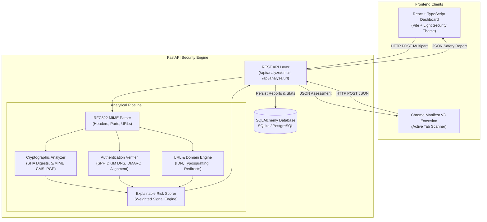

# EmailGuard

<div align="center">


[](https://python.org)
[](https://fastapi.tiangolo.com)
[](https://react.dev)
[](https://www.typescriptlang.org)
[](https://vitejs.dev)
[](https://tailwindcss.com)
[](LICENSE)

**Multi-Layer Email & Web Security Analyzer**  
*Analyze. Verify. Score. Protect.*

[Live Demo](#quickstart) • [CNS Syllabus Alignment](#cns-syllabus-connections) • [Risk Model](#explainable-risk-scoring-model) • [API Reference](#api-reference) • [Demo Email Suite](#synthetic-demo-email-bank)

</div>

---

## 📌 Executive Summary

**EmailGuard** is an end-to-end multi-layer security analyzer engineered to detect email spoofing, phishing, cryptographic forgery, and deceptive web destinations. Built as a prototype for the **Cryptography and Network Security (CNS)** domain, EmailGuard parses raw `.eml` files and URLs, correlates cryptographic signatures, domain reputation records, and structural signals, and generates a fully transparent **0–100 Safety Score** alongside clear classification verdicts (**SAFE**, **SUSPICIOUS**, or **MALICIOUS**) and actionable guidance.

The platform provides a complete ecosystem consisting of:
1. **FastAPI Security Engine:** High-performance asynchronous backend powering all cryptographic, DNS, and analytical checks.
2. **Modern Web Workspace:** A polished React + TypeScript + Vite dashboard designed with an accessible Light SOC interface, responsive telemetry charts, and step-by-step diagnostic reports.
3. **Chrome Manifest V3 Extension:** A browser popup enabling instant passive inspection of active web tabs against the EmailGuard risk engine.
4. **Synthetic Test Bank:** An 18-sample synthetic `.eml` test suite demonstrating authentic signatures, tampered payloads, look-alike domains, and spoofed headers.

---

## 🎓 CNS Syllabus Connections

EmailGuard directly bridges academic network security theory with real-world defensive engineering:

| CNS Syllabus Topic | Theoretical Concept | Concrete EmailGuard Implementation |
|---|---|---|
| **Asymmetric Cryptography** | Public/Private Key pairs, RSA/ECC validation | Validates DKIM domain key records retrieved from DNS; extracts X.509 TLS certificate public keys and key sizes. |
| **Cryptographic Integrity** | One-way hashing & collision resistance | Calculates SHA-256 and SHA-512 cryptographic message digests over normalized RFC822 message bodies to guarantee content integrity. |
| **Digital Signatures & PKI** | Signatures, Certificate Authorities, Trust Chains | Verifies S/MIME CMS signatures via OpenSSL and checks X.509 certificate chains against the `certifi` CA root store; inspects PGP/OpenPGP inline signatures. |
| **Internet Security Protocols** | Email identity & anti-spoofing standards | Computes SPF authorization, DKIM cryptographic authenticity, and DMARC alignment against live DNS TXT policies. |
| **Network Security & SSRF Defense** | Safe network boundary traversal | Implements strict SSRF protection: blocks private, loopback, and multicast IP ranges; restricts probes to public ports 80/443; enforces HEAD requests and caps redirect chains. |
| **Phishing & Threat Intelligence** | Homograph attacks, Typosquatting, Social Engineering | Evaluates IDN/Punycode domains, detects brand look-alikes via Levenshtein string-similarity (RapidFuzz), flags sensitive paths (`/login`, `/banking`), and scans non-standard ports. |

---

## 🏗️ System Architecture



---

## ⚙️ Core Capabilities

### 1. Email Message Parsing (RFC 822 / MIME)
* **Header Deconstruction:** Parses `From`, `To`, `Reply-To`, `Return-Path`, `Message-ID`, `Date`, and multi-hop `Received` headers.
* **Authentication-Results Extraction:** Scrapes receiver-reported evidence while clearly distinguishing between upstream receiver claims and live client checks.
* **Safe Attachment Handling:** Analyzes attachment metadata (MIME type, declared filename, byte size) without executing or opening file payloads.

### 2. Cryptographic Verification & Integrity
* **Message Hashes:** Produces verifiable SHA-256 and SHA-512 digests over the message text for audit trails.
* **DKIM Verification:** Cryptographically validates `DKIM-Signature` headers against the sender domain's public key published in DNS via `dkimpy`.
* **S/MIME Signature Verification:** Executes OpenSSL CMS to evaluate signature mathematical validity and validates certificate chain trust up to trusted root CAs.
* **PGP / GPG Presence:** Detects ASCII-armored OpenPGP blocks and verifies them when keyrings are configured.

### 3. Domain & Web Threat Intelligence
* **Brand Look-Alike & Typosquatting:** Uses RapidFuzz Levenshtein distance metrics against major brands (PayPal, Google, Microsoft, Apple, Amazon, etc.) to flag homoglyph substitutions.
* **URL Structure Inspection:** Detects raw IP literals, non-standard HTTP ports, deeply nested subdomains, excessive percent-encoding, and suspicious keywords.
* **Safe Active Probing (Optional):** Supports bounded `HEAD` requests to inspect destination redirect hops and TLS certificate validity while strictly refusing internal/private IP ranges.

### 4. User Interface & Chrome Extension
* **Modern Light Security Theme:** Styled with a custom color palette (`#B6FFFA` ice cyan, `#98E4FF` sky blue, `#80B3FF` periwinkle blue, and `#687EFF` royal indigo).
* **Interactive Telemetry:** Live AreaChart security activity graphs, animated donut distribution rings with segment telemetry, and instant metric sparklines.
* **Manifest V3 Extension:** Inspects the active browser tab URL via the same backend engine with no page scraping or intrusive permissions.

---

## 🧮 Explainable Risk Scoring Model

EmailGuard calculates a **Safety Score** derived directly from observable threat indicators:

$$\text{Safety Score} = \max(0, \min(100, 100 - \text{Total Risk Score}))$$

### Signal Contribution Matrix

| Signal Category | Trigger Condition | Score Contribution |
|---|---|:---:|
| **Authentication Failures** | Hard SPF Failure / Softfail | `+15` / `+7` |
| | DKIM Cryptographic Verification Failed | `+15` |
| | DMARC Policy Rejection / Alignment Failed | `+20` |
| **Phishing & URL Risks** | Brand Typosquatting / Look-alike Domain Detected | `+25` |
| | High-Risk Structural URL Pattern | `+20` |
| | Suspicious Redirect Hop / HTTP Downgrade | `+20` |
| | TLS Certificate Expired / Hostname Mismatch | `+25` |
| | Raw IP Literal in Destination URL | `+10` |
| | Sensitive Path Detected (e.g., `/login`, `/banking`) | `+6` |
| **Sender DNS Validation** | Visible From Domain has no MX, A, AAAA or NS records | `+10` |
| **Positive Trust Evidence** | DKIM Signature Passed | `-5` |
| | DMARC Alignment Passed | `-10` |
| | Valid Trusted TLS Handshake | `-2` |
| **Passive-Only Baseline** | Limited external evidence | `+8` |

### Core Evaluation Principle: "Cannot Verify" $\neq$ "Failed"

In strict accordance with network security standards, inconclusive states do **not** penalize the sender:
* An unpublished or unreachable DKIM selector is flagged as `KEY_UNAVAILABLE` (`+0` risk).
* A domain that has not configured DMARC TXT records is marked `NO_POLICY` (`+0` risk).
* Temporary DNS server timeout is reported as `DNS_ERROR` (`+0` risk).
* S/MIME signatures without an imported root CA are designated `PASS_SIG_ONLY` (`+0` risk penalty).

### Classification Thresholds

* 🟢 **80 – 100:** `SAFE` (Action: **ALLOW**) — Low observed threat indicators.
* 🟡 **50 – 79:** `SUSPICIOUS` (Action: **WARN**) — Moderate anomalies detected; manual scrutiny advised.
* 🔴 **00 – 49:** `MALICIOUS` (Action: **QUARANTINE**) — High-confidence spoofing, phishing, or cryptographic failure detected.

---

## 📁 Project Structure

```text
EmailGuard/
├── demo_emails/                  18 synthetic .eml test files & presentation guide
│   ├── safe/                     Valid DKIM, S/MIME, and trusted enterprise samples
│   ├── dangerous/                Spoofed SPF, forged DMARC, look-alike links, bad S/MIME
│   └── DEMO_GUIDE.md             Measured viva presentation guide & execution walkthrough
├── emailguard/
│   ├── backend/                  FastAPI security engine
│   │   ├── app/
│   │   │   ├── analyzers/        MIME, Auth (SPF/DKIM/DMARC), Crypto (S/MIME/PGP), URL
│   │   │   ├── models/           Database entities (Analysis, URL, Attachment records)
│   │   │   ├── service.py        Master analysis pipeline
│   │   │   └── main.py           FastAPI REST routing & lifespan
│   │   ├── evaluate_dataset.py   Confusion matrix & accuracy evaluation script
│   │   ├── requirements.txt      Core Python dependencies
│   │   └── requirements-dev.txt  Pytest & testing utilities
│   ├── frontend/                 React + TypeScript + Vite dashboard
│   │   ├── src/
│   │   │   ├── components/       Sidebar, Dashboard, EmailWorkspace, UrlWorkspace, ScoreRing
│   │   │   ├── tokens.css        Color design tokens (Light palette: #B6FFFA to #687EFF)
│   │   │   ├── styles.css        Component CSS & responsive design system
│   │   │   └── App.tsx           Root view state & router
│   │   ├── index.html            HTML template
│   │   └── vite.config.ts        Vite build configuration & backend API proxy
│   ├── extension/                Chrome Manifest V3 Extension
│   │   ├── popup/                Active URL risk popup interface
│   │   ├── background/           Service worker coordinating API requests
│   │   └── manifest.json         MV3 configuration
│   └── docker-compose.yml        Multi-container configuration (PostgreSQL + API + UI)
├── emailguard.db                 Local SQLite persistence database
└── README.md                     Master repository documentation
```

---

## 🚀 Quickstart

### Prerequisites
* **Python:** 3.11 or higher
* **Node.js:** v18 or higher (with `npm`)
* **OpenSSL:** Available on system `PATH` (for S/MIME verification)

---

### Step 1: Start the FastAPI Backend

Open a terminal and navigate to the backend directory:

```bash
cd emailguard/backend

# Create and activate virtual environment
python -m venv .venv

# Windows PowerShell:
.venv\Scripts\Activate.ps1
# Linux/macOS:
# source .venv/bin/activate

# Install dependencies
pip install -r requirements-dev.txt

# Start the development server
uvicorn app.main:app --reload --host 127.0.0.1 --port 8000
```

* **Interactive Swagger UI:** [http://127.0.0.1:8000/docs](http://127.0.0.1:8000/docs)
* **Health Endpoint:** [http://127.0.0.1:8000/api/health](http://127.0.0.1:8000/api/health)

---

### Step 2: Start the React Frontend

Open a second terminal and navigate to the frontend directory:

```bash
cd emailguard/frontend

# Install dependencies
npm install

# Start Vite dev server
npm run dev
```

* **Web Application:** [http://localhost:5173/](http://localhost:5173/)  
* The Vite dev server automatically proxies `/api/*` requests to the running backend on port 8000.

---

### Step 3: Load the Chrome Extension (Optional)

1. Open Google Chrome and navigate to `chrome://extensions/`.
2. Enable **Developer mode** using the toggle in the top-right corner.
3. Click **Load unpacked** and select the `emailguard/extension/` folder.
4. Pin the **EmailGuard** icon to your toolbar and click it on any HTTP/HTTPS page to scan the URL.

---

### Step 4: Docker Compose Deployment (Alternative)

To run the entire stack with a dedicated PostgreSQL database:

```bash
cd emailguard
docker compose up --build
```
* **Frontend:** [http://localhost:8080](http://localhost:8080)
* **Backend API:** [http://localhost:8000](http://localhost:8000)

---

## 📡 API Reference

| Method | Endpoint | Description | Sample Payload |
|---|---|---|---|
| `GET` | `/api/health` | Health check & engine capability status | *None* |
| `POST` | `/api/analyze/email` | Upload and analyze an `.eml` file | Multipart form-data: `file=@sample.eml` |
| `POST` | `/api/analyze/url` | Passive or active inspection of a URL | `{"url": "https://paypa1-security.com", "network_checks": false}` |
| `GET` | `/api/analyze/{id}` | Retrieve full historical analysis report | *None* |
| `GET` | `/api/history` | List recent analysis summaries (limit query) | `?limit=50` |
| `GET` | `/api/dashboard/stats`| Global analytics, risk distribution, trends | *None* |

---

## 🧪 Testing & Evaluation

### Running Automated Test Suite
From `emailguard/backend/`:
```bash
pytest -v
```

### End-to-End Cryptographic Validation
`tests/test_crypto_signatures.py` dynamically creates throw-away RSA keys and generates real OpenSSL CMS S/MIME signatures on the fly, proving the cryptographic verification path functions against live signed data.

### Dataset Evaluation & Confusion Matrix
To evaluate EmailGuard's detection metrics against the sample corpus:
```bash
python evaluate_dataset.py
```
Outputs total test instances, detection rates, false-positive counts, and mean execution latency.

---

## 🛡️ Privacy & Threat Model

* **No Payload Storage:** Raw email bodies and decoded messages are never persisted to disk or database. Only extracted cryptographic digests, domain references, and score metadata are stored.
* **Safe Attachment Handling:** Attachments are evaluated for MIME type and file extension anomalies; they are never opened, rendered, or executed.
* **Air-Gap Compatible:** All active URL checking is disabled by default. DNS lookups can be completely deactivated via `EMAILGUARD_DNS_LOOKUPS=false` for restricted or offline environments.
* **SSRF Hardened:** Probing modules validate IP classifications via `ipaddress.is_global` and strictly reject private, loopback, link-local, and cloud metadata addresses (e.g., `169.254.169.254`).

---

## 👥 Authors & Academic Context

* **Project:** EmailGuard Security Workspace
* **Course:** Cryptography and Network Security (CNS) — Semester 5
* **Repository:** [adeshsavaratkar21/EmailGuard](https://github.com/adeshsavaratkar21/EmailGuard)
